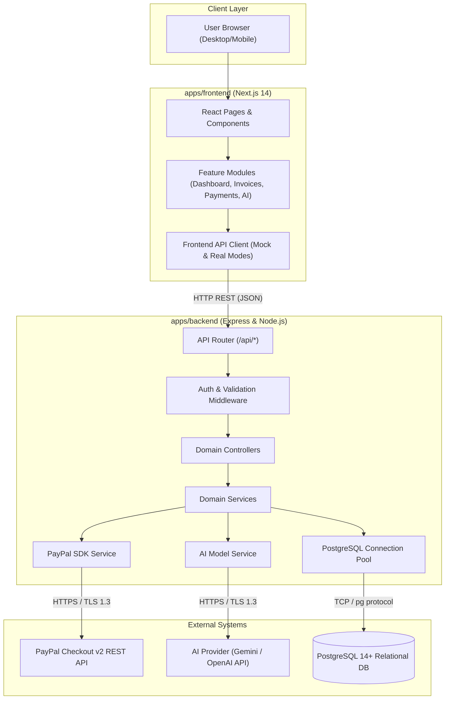

# PayPilot AI - System Architecture

**Architectural Blueprint & Technical Specifications**  
**Version:** 1.0.0

---

## 1. System Overview

**PayPilot AI** is an AI-assisted invoice and payment management platform engineered specifically for freelancers and small businesses. It enables users to:
1. Generate itemized, professional invoices in seconds using AI assistance.
2. Track financial performance with real-time analytics and statistics.
3. Accept immediate global payments via PayPal Checkout Sandbox.
4. Automate courteous, intelligent payment reminder drafts.

### High-Level Architectural Flow


---

## 2. Monorepo Organization

PayPilot AI is organized as a lightweight, modular npm workspace monorepo.

```text
paypilot-ai/
├── apps/
│   ├── frontend/         # Next.js 14 Web Application (JavaScript + React)
│   └── backend/          # Express REST API (Node.js)
├── packages/
│   └── shared/           # Common constants, enum definitions, error codes
├── database/             # PostgreSQL DDL schemas and migration scripts
└── docs/                 # Architectural specifications and module guides
```

### Decoupling Guarantee
- **Independent Execution:** The frontend and backend can be run in separate terminals or even deployed to independent cloud hosts (e.g. Vercel for frontend, Render/Fly.io/Docker for backend).
- **Clear Contracts:** The frontend and backend communicate exclusively over standard JSON HTTP APIs defined in [`docs/API_CONTRACTS.md`](./API_CONTRACTS.md).
- **Shared Constants:** The `@paypilot/shared` package ensures that domain statuses (`PAID`, `SENT`, `OVERDUE`) and HTTP error codes are defined in exactly one place.

---

## 3. Technology Stack Rationale

| Layer | Chosen Technology | Architectural Rationale |
| :--- | :--- | :--- |
| **Frontend** | React + Next.js (JavaScript) | App Router provides fast server rendering, zero-config routing, responsive layouts, and built-in proxying to backend APIs during development. |
| **Styling** | Modern CSS | Native, zero-runtime CSS with modern variables and utility tokens avoids heavy build dependencies while maintaining custom styling freedom. |
| **Backend** | Node.js + Express | Minimalist, unopinionated, high-throughput REST architecture with rapid onboarding for open-source contributors. |
| **Database** | PostgreSQL | Relational ACID transactions are critical for financial invoicing and ledger balances. `NUMERIC(12, 2)` eliminates floating-point rounding bugs. |
| **Payments** | PayPal Sandbox | Industry-standard checkout flow with server-side capture verification. |
| **AI Layer** | Backend Service Abstraction | Isolates API keys on the server. Allows swapping between Google Gemini or OpenAI with zero frontend code changes. |
| **Testing** | Vitest | Fast, ESM-native testing framework compatible with modern React and Node.js testing. |

---

## 4. Security Architecture & Invariants

### 4.1. Server-Side PayPal Verification
Under no circumstances should the client browser determine whether a payment was successful. The client only receives the PayPal `orderID`, which it immediately sends to the backend `POST /api/payments/capture-order`. The backend authenticates directly with PayPal's API using `PAYPAL_CLIENT_SECRET` to capture the funds and verify the amount before transitioning the invoice status to `PAID`.

### 4.2. AI Output Quarantine
AI model outputs are treated as untrusted suggestions. The AI assistant can draft descriptions and email messages, but cannot directly update database records or financial balances without human confirmation via explicit API actions.

### 4.3. Environment Isolation
All sensitive API credentials (`PAYPAL_CLIENT_SECRET`, `AI_API_KEY`, `DB_PASSWORD`, `JWT_SECRET`) reside exclusively in the backend runtime. The frontend only receives safe, public configurations (`NEXT_PUBLIC_*`).

---

## 5. Offline & Mock Development Architecture

To enable teammates to fork the repository and immediately build features without waiting for external API keys:
1. **Frontend Mock Switch:** When `NEXT_PUBLIC_ENABLE_MOCK_API=true`, frontend services can fall back to realistic mock datasets.
2. **Backend Safe Mode:** When `ALLOW_OFFLINE_DB=true`, the backend initializes an in-memory data store if PostgreSQL is unreachable.
3. **AI Mock Fallback:** When `AI_PROVIDER=mock`, the backend generates structured mock responses mimicking Gemini/OpenAI outputs.
