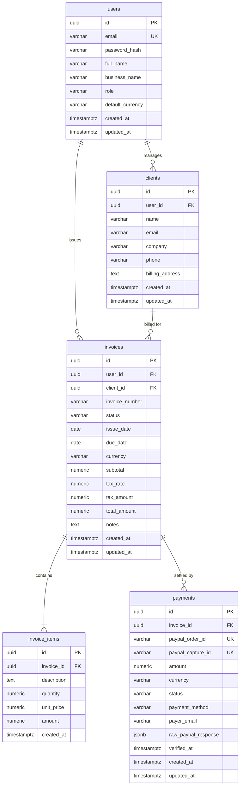
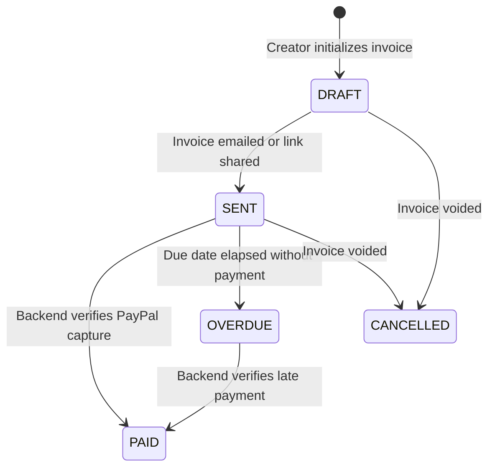
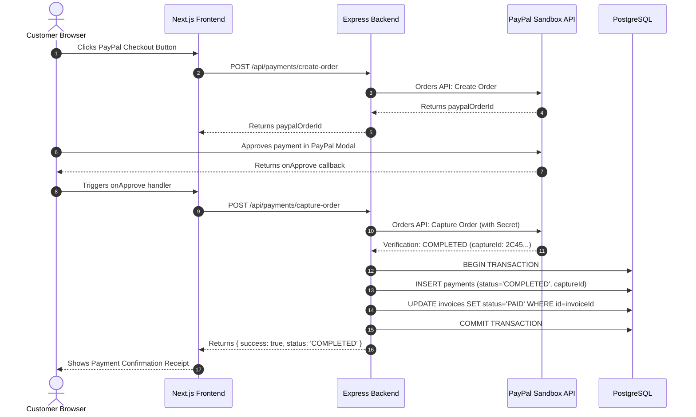

# PayPilot AI - Database Schema & Data Architecture

**Database Engine:** PostgreSQL 14+  
**Target Schema Version:** `1.0.0`  
**DDL Source:** [`database/schema.sql`](../database/schema.sql)

This document provides architectural rationale, entity-relationship diagrams (ERD), field-level constraints, and data integrity requirements for PayPilot AI.

---

## 1. Entity-Relationship Diagram

---

## 2. Table Specifications & Rules

### 2.1. `users`
Represents the authenticated freelancer or business entity who creates invoices.

| Column | Type | Constraints | Description |
| :--- | :--- | :--- | :--- |
| `id` | `UUID` | `PRIMARY KEY DEFAULT gen_random_uuid()` | Unique user identifier. |
| `email` | `VARCHAR(255)` | `NOT NULL UNIQUE` | Login email address. |
| `password_hash` | `VARCHAR(255)` | `NOT NULL` | Bcrypt or Argon2 password hash. |
| `full_name` | `VARCHAR(120)` | `NOT NULL` | Real name of freelancer / owner. |
| `business_name` | `VARCHAR(150)` | `NULLABLE` | Optional registered business or DBA. |
| `role` | `VARCHAR(30)` | `NOT NULL DEFAULT 'FREELANCER' CHECK (role IN ('FREELANCER', 'BUSINESS', 'ADMIN'))` | Authorization role. |
| `default_currency` | `VARCHAR(3)` | `NOT NULL DEFAULT 'USD'` | ISO 4217 standard currency code. |
| `created_at` | `TIMESTAMPTZ` | `NOT NULL DEFAULT CURRENT_TIMESTAMP` | Account creation timestamp. |
| `updated_at` | `TIMESTAMPTZ` | `NOT NULL DEFAULT CURRENT_TIMESTAMP` | Last profile update timestamp. |

---

### 2.2. `clients`
Represents the customers/clients who receive invoices.

| Column | Type | Constraints | Description |
| :--- | :--- | :--- | :--- |
| `id` | `UUID` | `PRIMARY KEY DEFAULT gen_random_uuid()` | Unique client identifier. |
| `user_id` | `UUID` | `NOT NULL REFERENCES users(id) ON DELETE CASCADE` | Owner user. |
| `name` | `VARCHAR(150)` | `NOT NULL` | Primary contact name. |
| `email` | `VARCHAR(255)` | `NOT NULL` | Destination billing email. |
| `company` | `VARCHAR(150)` | `NULLABLE` | Client legal organization name. |
| `phone` | `VARCHAR(50)` | `NULLABLE` | Optional phone number. |
| `billing_address` | `TEXT` | `NULLABLE` | Street, city, state, postal code. |
| `created_at` | `TIMESTAMPTZ` | `NOT NULL DEFAULT CURRENT_TIMESTAMP` | Record creation. |
| `updated_at` | `TIMESTAMPTZ` | `NOT NULL DEFAULT CURRENT_TIMESTAMP` | Record update. |

---

### 2.3. `invoices`
Core financial document issued by a user to a client.

| Column | Type | Constraints | Description |
| :--- | :--- | :--- | :--- |
| `id` | `UUID` | `PRIMARY KEY DEFAULT gen_random_uuid()` | Unique invoice identifier. |
| `user_id` | `UUID` | `NOT NULL REFERENCES users(id) ON DELETE CASCADE` | Issuing user. |
| `client_id` | `UUID` | `NOT NULL REFERENCES clients(id) ON DELETE RESTRICT` | Target recipient client. |
| `invoice_number` | `VARCHAR(50)` | `NOT NULL` | Human-readable sequential ID (e.g. `INV-2026-001`). |
| `status` | `VARCHAR(20)` | `NOT NULL DEFAULT 'DRAFT' CHECK (status IN ('DRAFT', 'SENT', 'PAID', 'OVERDUE', 'CANCELLED'))` | Lifecycle state. |
| `issue_date` | `DATE` | `NOT NULL DEFAULT CURRENT_DATE` | Invoice issuance date. |
| `due_date` | `DATE` | `NOT NULL` | Payment deadline. |
| `currency` | `VARCHAR(3)` | `NOT NULL DEFAULT 'USD'` | Currency symbol. |
| `subtotal` | `NUMERIC(12, 2)` | `NOT NULL DEFAULT 0.00 CHECK (subtotal >= 0)` | Sum of item amounts. |
| `tax_rate` | `NUMERIC(5, 2)` | `NOT NULL DEFAULT 0.00 CHECK (tax_rate >= 0)` | Percentage tax rate. |
| `tax_amount` | `NUMERIC(12, 2)` | `NOT NULL DEFAULT 0.00 CHECK (tax_amount >= 0)` | Calculated tax value. |
| `total_amount` | `NUMERIC(12, 2)` | `NOT NULL DEFAULT 0.00 CHECK (total_amount >= 0)` | `subtotal + tax_amount`. |
| `notes` | `TEXT` | `NULLABLE` | Payment terms or client message. |
| `created_at` | `TIMESTAMPTZ` | `NOT NULL DEFAULT CURRENT_TIMESTAMP` | Record creation. |
| `updated_at` | `TIMESTAMPTZ` | `NOT NULL DEFAULT CURRENT_TIMESTAMP` | Record update. |

> **Constraint:** `UNIQUE(user_id, invoice_number)` prevents duplicate invoice numbers per user.

---

### 2.4. `invoice_items`
Itemized billable services or goods on an invoice.

| Column | Type | Constraints | Description |
| :--- | :--- | :--- | :--- |
| `id` | `UUID` | `PRIMARY KEY DEFAULT gen_random_uuid()` | Unique line item identifier. |
| `invoice_id` | `UUID` | `NOT NULL REFERENCES invoices(id) ON DELETE CASCADE` | Associated invoice. |
| `description` | `TEXT` | `NOT NULL` | Clear deliverable description. |
| `quantity` | `NUMERIC(10, 2)` | `NOT NULL DEFAULT 1.00 CHECK (quantity > 0)` | Units or hours. |
| `unit_price` | `NUMERIC(12, 2)` | `NOT NULL DEFAULT 0.00 CHECK (unit_price >= 0)` | Cost per unit. |
| `amount` | `NUMERIC(12, 2)` | `NOT NULL DEFAULT 0.00 CHECK (amount >= 0)` | `quantity * unit_price`. |
| `created_at` | `TIMESTAMPTZ` | `NOT NULL DEFAULT CURRENT_TIMESTAMP` | Creation time. |

---

### 2.5. `payments`
Immutable financial transactions recorded against invoices.

| Column | Type | Constraints | Description |
| :--- | :--- | :--- | :--- |
| `id` | `UUID` | `PRIMARY KEY DEFAULT gen_random_uuid()` | Unique internal transaction identifier. |
| `invoice_id` | `UUID` | `NOT NULL REFERENCES invoices(id) ON DELETE RESTRICT` | Settled invoice. |
| `paypal_order_id`| `VARCHAR(100)` | `NOT NULL UNIQUE` | Order ID issued by PayPal Checkout API. |
| `paypal_capture_id`| `VARCHAR(100)` | `UNIQUE NULLABLE` | Capture ID issued upon successful funds capture. |
| `amount` | `NUMERIC(12, 2)` | `NOT NULL CHECK (amount > 0)` | Verified captured amount. |
| `currency` | `VARCHAR(3)` | `NOT NULL DEFAULT 'USD'` | Currency code. |
| `status` | `VARCHAR(20)` | `NOT NULL DEFAULT 'PENDING' CHECK (status IN ('PENDING', 'COMPLETED', 'FAILED', 'REFUNDED'))` | Verification state. |
| `payment_method` | `VARCHAR(30)` | `NOT NULL DEFAULT 'PAYPAL'` | Provider identifier. |
| `payer_email` | `VARCHAR(255)` | `NULLABLE` | PayPal account email of payer. |
| `raw_paypal_response` | `JSONB` | `NULLABLE` | Complete audit payload from PayPal. |
| `verified_at` | `TIMESTAMPTZ` | `NULLABLE` | Backend verification timestamp. |
| `created_at` | `TIMESTAMPTZ` | `NOT NULL DEFAULT CURRENT_TIMESTAMP` | Initiation time. |
| `updated_at` | `TIMESTAMPTZ` | `NOT NULL DEFAULT CURRENT_TIMESTAMP` | Last status update. |

---

## 3. Financial Lifecycle & State Transitions

### 3.1. Invoice Status State Machine

### 3.2. Payment Verification Rule (Strict Security Invariant)

> **IMPORTANT ARCHITECTURAL RULE:**
> 1. AI model responses MUST NEVER update or determine invoice or payment statuses.
> 2. The client frontend MUST NEVER directly update the database status to `PAID`.
> 3. An invoice is only `PAID` after step 9 in the diagram above has succeeded.
